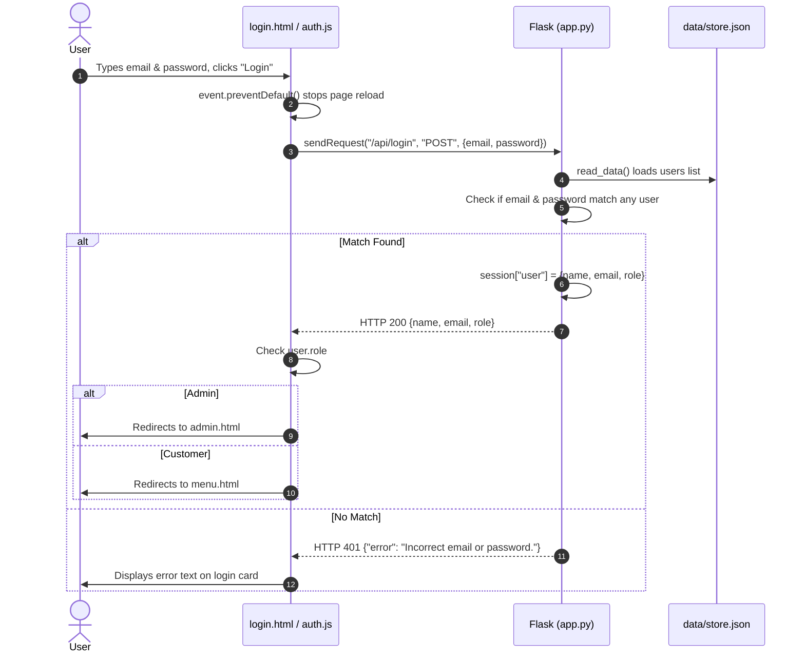

# The Banyan Kitchen — Complete Project Documentation

Welcome to **The Banyan Kitchen**, a full-featured online restaurant ordering and management web application. 

This project is built using **Python (Flask)** on the backend, **HTML5, CSS3 (Bootstrap 5), and Vanilla JavaScript** on the frontend, and a simple **JSON file (`data/store.json`)** for persistent data storage.

---

## 💡 Simplified Design Philosophy

All complex and advanced programming features (such as `async`/`await`, nested arrow functions, complicated array reducers, and heavy data-science libraries like `pandas`) have been **removed or replaced with clean, easy-to-read functions**.

* **No `async` / `await`:** All network communication uses standard functions with callback handlers (`onSuccess`, `onError`).
* **Standard JavaScript Functions:** Instead of cryptic one-liners and arrow functions (`=>`), the code uses standard named and anonymous `function(...) { ... }` blocks with clear variable names.
* **Simple Loops:** Calculations (like cart totals, cart counts, and revenue) use standard `for` loops that are easy to trace.
* **Standard Python Library:** The backend uses Python's built-in `json` module rather than external data processing libraries.

---

## 📁 Project Directory Structure

```text
The_Banyan_Kitchen/
│
├── app.py                     # Flask server, routing, authentication, and REST APIs
├── requirements.txt           # Python dependencies (Flask only)
├── README.md                  # Comprehensive project documentation
│
├── data/
│   └── store.json             # File-based database (foods, users, carts, orders, messages)
│
├── templates/                 # Frontend HTML pages (Jinja2 templates)
│   ├── index.html             # Home page with hero section & featured items
│   ├── menu.html              # Full menu with search and category filters
│   ├── cart.html              # Shopping cart and checkout page
│   ├── login.html             # Login and account registration page
│   ├── admin.html             # Admin dashboard for food and order management
│   ├── about.html             # Restaurant story and details
│   └── contact.html           # Contact form and location details
│
└── static/
    ├── css/
    │   └── style.css          # Custom styling and branding
    ├── assets/images/         # Images for dishes, restaurant interior, and hero
    └── js/
        ├── common.js          # Shared functions (sendRequest, updateCartCount, updateUserMenu)
        ├── home.js            # Home page featured food display
        ├── menu.js            # Menu rendering, category filter, live search, and add to cart
        ├── cart.js            # Cart rendering, quantity adjustment, subtotal & checkout
        ├── auth.js            # Login and registration form handling
        ├── contact.js         # Contact message submission
        └── admin.js           # Admin dashboard, stats, food CRUD, order status updater
```

---

## 🛠️ The Heart of the Frontend: `sendRequest()`

To replace complex `async/await` syntax while still communicating smoothly with the server, all JavaScript files use a simple helper function called `sendRequest`:

```javascript
function sendRequest(url, method, data, onSuccess, onError) {
  var options = {
    method: method ? method : "GET",
    headers: { "Content-Type": "application/json" }
  };

  if (data) {
    options.body = JSON.stringify(data);
  }

  fetch(url, options)
    .then(function(response) {
      if (response.status === 204) {
        return null; // No content returned (e.g., logout or delete)
      }
      return response.json();
    })
    .then(function(result) {
      if (result && result.error) {
        if (onError) onError(result.error);
      } else {
        if (onSuccess) onSuccess(result);
      }
    })
    .catch(function(error) {
      if (onError) {
        onError("Something went wrong. Please check your connection.");
      }
    });
}
```

### How `sendRequest()` Works:
1. **`url`**: The endpoint you want to talk to (e.g. `/api/login` or `/api/cart`).
2. **`method`**: The HTTP action (`"GET"`, `"POST"`, `"PATCH"`, `"PUT"`, or `"DELETE"`).
3. **`data`**: Any JavaScript object you want to send to the server (converted automatically to a JSON string).
4. **`onSuccess`**: A function that runs when the server responds with success.
5. **`onError`**: A function that runs if something goes wrong or an error message is returned.

---

## 🔐 Deep Dive 1: How Login and Registration Work

### 1. The Login Flow


#### Step-by-Step Explanation:
1. **User input:** The user enters their email and password into the inputs on `login.html` and clicks the **Login** button.
2. **Form event captured:** In `static/js/auth.js`, the `loginForm` has a `submit` listener:
   ```javascript
   loginForm.addEventListener("submit", function(event) {
     event.preventDefault(); // Prevents normal browser form reload
     var loginData = {
       email: loginEmail.value.trim(),
       password: loginPassword.value
     };
     sendRequest("/api/login", "POST", loginData, onSuccess, onError);
   });
   ```
3. **Flask receives request:** In `app.py`, the `@app.post("/api/login")` route receives the JSON payload.
4. **Verification:** Flask reads `data/store.json` and loops through the `users` array. It compares the entered email and password.
5. **Session storage:** If a match is found:
   - Flask stores the user details (name, email, role) inside Flask's secure `session["user"]`. This sets a secure HTTP cookie in the user's browser.
   - Flask returns the user object (excluding the password for safety).
6. **Redirect:**
   - In `auth.js`, the `onSuccess` callback runs:
     ```javascript
     if (user.role === "admin") {
       window.location.href = "admin.html";
     } else {
       window.location.href = "menu.html";
     }
     ```
7. **Navbar update:** On every page load, `common.js` calls `/api/current-user`:
   - If the user is logged in, the **LOGIN** button in the navbar changes to **LOGOUT**.
   - If the user has `role: "admin"`, an **ADMIN** link is dynamically added to the navigation bar.

---

### 2. The Registration Flow
1. On `login.html`, clicking **"Create an account"** hides the login form and displays the registration form.
2. The user enters **Name**, **Email**, and a **Password** (minimum 4 characters).
3. `auth.js` sends `POST /api/register` with this information.
4. In `app.py`:
   - It checks whether an account with that email already exists. If yes, returns an error: *"An account already exists for this email address."*
   - If new, creates a user object with `role: "customer"`.
   - Appends the new user to `users` in `store.json` and writes it to disk.
   - Automatically logs the user in by setting `session["user"]`.
5. The browser redirects the new customer straight to `menu.html`.

---

## 🛒 Deep Dive 2: How "Add to Cart" Works

```mermaid
sequenceDiagram
    autonumber
    actor Customer
    participant Page as menu.html / menu.js
    participant Common as common.js
    participant Server as Flask (app.py)
    participant Database as data/store.json

    Customer->>Page: Clicks "+" button on a food card
    Page->>Page: Get foodId from data-id attribute
    Page->>Server: sendRequest("/api/cart", "POST", { food_id: foodId })
    Server->>Server: cart_key() gets/creates user session UUID
    Server->>Database: read_data()
    Server->>Server: Verify item exists and quantity > 0
    Server->>Database: cart[food_id] = current_qty + 1; write_data()
    Server-->>Page: HTTP 201 {"message": "Item added to cart."}
    Page->>Customer: alert("Item added to cart!")
    Page->>Common: updateCartCount()
    Common->>Server: sendRequest("/api/cart", "GET")
    Server-->>Common: Return cart items array
    Common->>Common: Loop & calculate totalQuantity
    Common->>Page: document.getElementById("cartCount").textContent = totalQuantity
```

#### Step-by-Step Explanation:
1. **Rendering items with data attributes:** When the menu loads, each item card is rendered with an "Add to Cart" button that stores the food's ID in a data attribute:
   ```html
   <button class="add-button" data-id="1">
     <i class="bi bi-plus-lg"></i>
   </button>
   ```
2. **Click event:** In `static/js/menu.js`, an event listener is attached to every `.add-button`:
   ```javascript
   button.addEventListener("click", function() {
     var foodId = Number(this.getAttribute("data-id"));
     addToCart(foodId);
   });
   ```
3. **Triggering `addToCart()`:**
   ```javascript
   function addToCart(foodId) {
     sendRequest("/api/cart", "POST", { food_id: foodId }, function(response) {
       updateCartCount();
       alert("Item added to cart!");
     });
   }
   ```
4. **Backend logic in `app.py` (`add_cart_item()`):**
   - Each visitor gets a unique cart session ID generated by `cart_key()` (stored in Flask's session). This means guests can add items to their cart even before logging in!
   - The backend checks `data["foods"]` to confirm the item exists and that available stock `quantity >= 1`.
   - It retrieves the user's cart: `data["carts"][cart_key]`.
   - It increases the count for this `food_id` by 1 (up to the available stock limit).
   - The updated data dictionary is saved into `data/store.json`.
   - The server replies with HTTP 201: `{"message": "Item added to cart."}`.
5. **Updating the Cart Badge in the Navbar:**
   - In the success callback, `updateCartCount()` from `common.js` is called.
   - It asks the backend for `/api/cart`.
   - It runs a simple `for` loop to count the total items:
     ```javascript
     var totalQuantity = 0;
     for (var i = 0; i < cartItems.length; i++) {
       totalQuantity = totalQuantity + cartItems[i].quantity;
     }
     cartCountElement.textContent = totalQuantity;
     ```
   - The badge in the navbar `<span id="cartCount">` updates immediately (e.g. from `0` to `1`).

---

## 🧾 Deep Dive 3: How the Cart & Checkout Work

### 1. Viewing the Cart (`cart.html`)
When you navigate to `cart.html`, `static/js/cart.js` automatically calls `showCart()`:
1. Calls `sendRequest("/api/cart", "GET")`.
2. Flask looks up the user's session cart, finds the matching foods from `foods`, and returns a list of items with their individual names, images, prices, and quantities.
3. If the cart is empty, it displays: *"Your cart is empty. Explore the menu."*
4. If there are items, it builds the cart table showing:
   - Food image and name.
   - Price per item.
   - Quantity controls: **`−`**, quantity number, **`+`**, and **`Remove`**.
   - Total price for that line item (`price * quantity`).
5. **Calculating Bill Totals:**
   ```javascript
   var subtotal = 0;
   for (var i = 0; i < cart.length; i++) {
     subtotal = subtotal + (cart[i].price * cart[i].quantity);
   }
   var delivery = (subtotal > 0) ? 40 : 0; // Flat ₹40 delivery fee
   var grandTotal = subtotal + delivery;
   ```
   The values for **Subtotal**, **Delivery**, and **Total** are updated on the screen.

### 2. Modifying Quantities (+, −, Remove)
Each button has a `data-action` attribute:
* **`+` (plus):** sends `PATCH /api/cart/<food_id>` with `{ action: "plus" }`. Backend increments the count if stock permits.
* **`−` (minus):** sends `{ action: "minus" }`. Decrements the count by 1. If it reaches 0, the item is removed.
* **`Remove`:** sends `{ action: "remove" }`. Removes the item immediately.
* When the server confirms the update, `showCart()` and `updateCartCount()` are re-run so the page reflects the new numbers immediately without refreshing.

### 3. Placing an Order (Checkout)
When the customer clicks **"Place order"**:
1. `checkoutButton` sends `POST /api/checkout`.
2. **Server-Side Checks in `app.py`:**
   - **Is user logged in?** If not, returns HTTP 401: *"Please log in before placing an order."*
   - **Is cart empty?** If empty, returns HTTP 400: *"Your cart is empty."*
   - **Is stock available?** For each item in the cart, it verifies that `item["quantity"] <= food["quantity"]`.
3. **Deducting Inventory:**
   - The backend subtracts the ordered quantity directly from available stock in `data["foods"]`:
     ```python
     food["quantity"] = food["quantity"] - item["quantity"]
     ```
4. **Recording the Order:**
   - A new order record is created with a unique timestamp ID, customer email, items list, total amount, status (`"Received"`), and human-readable date.
   - The order is appended to `data["orders"]`.
   - The user's cart is emptied: `data["carts"][cart_key()] = {}`.
   - `write_data(data)` persists the changes to `store.json`.
5. **Frontend Feedback:**
   - Displays a green confirmation message: *"Order placed successfully! Order ID: #1794971508461"*.
   - Re-renders the cart (now empty) and resets the badge count to `0`.

---

## 🍽️ Deep Dive 4: Menu Page (Categories & Search)

The menu page (`menu.html` + `static/js/menu.js`) allows customers to browse, filter, and search for items.

1. **Initial Load:** `startMenu()` sends a `GET` request to `/api/foods`. It saves the full list in `allFoods`.
2. **Category Filter:**
   - Categories are: `["All", "Starters", "Main Course", "Pizza", "Burgers", "Desserts", "Drinks"]`.
   - Clicking any category button sets `selectedCategory` and re-runs `showFoods()`.
3. **Live Search:**
   - When the user types into `<input id="searchFood">`, the `input` event triggers `showFoods()` instantly:
   ```javascript
   for (var i = 0; i < allFoods.length; i++) {
     var food = allFoods[i];
     var categoryMatches = (selectedCategory === "All" || food.category === selectedCategory);
     var nameMatches = food.name.toLowerCase().indexOf(searchText) !== -1;

     if (categoryMatches && nameMatches) {
       matchingFoods.push(food);
     }
   }
   ```
4. **Stock Indication:**
   - If `quantity > 0`, it shows e.g. *"12 available"* and the `+` button is enabled.
   - If `quantity <= 0`, it displays *"Out of stock"* and disables the `+` button.

---

## 🛡️ Deep Dive 5: How the Admin Panel Works

The Admin Panel (`admin.html` + `static/js/admin.js`) is a dedicated dashboard for restaurant owners and staff.

### 1. Role-Based Protection
* **Backend:** Secured with the `@admin_required` Python decorator:
  ```python
  def admin_required(view_function):
      @wraps(view_function)
      def wrapped(*args, **kwargs):
          current_user = session.get("user")
          if not current_user or current_user.get("role") != "admin":
              return jsonify({"error": "Admin access required."}), 403
          return view_function(*args, **kwargs)
      return wrapped
  ```
* **Frontend:** When `admin.html` opens, `startAdmin()` calls `/api/current-user`:
  - If the user is not logged in or `role !== "admin"`, it displays an **"Admin access required"** warning and hides all dashboard controls.
  - If authorized, it unhides `#adminContent` and fetches all data.

### 2. Admin Capabilities:
1. **Live Statistics:**
   - **Food items:** Total number of dishes in the catalog.
   - **Total orders:** Total number of orders placed.
   - **Revenue:** Sum of all order totals calculated with a simple loop.
2. **Food Item Management (CRUD):**
   - **Add Item:** Fill out food name, category, price, image URL, and available stock, then click "Save food item" (sends `POST /api/admin/foods`).
   - **Edit Item:** Click "Edit" next to any food item. The form fills with its details. Clicking "Update food item" sends `PUT /api/admin/foods/<id>`.
   - **Delete Item:** Click "Delete" next to any food item (sends `DELETE /api/admin/foods/<id>`).
3. **Customer Orders & Status Management:**
   - Displays all customer orders with customer email, ordered items, and total amount.
   - Each order has a status dropdown: `Received`, `Preparing`, `Completed`, or `Cancelled`.
   - Selecting a new status immediately sends `PATCH /api/admin/orders/<id>` to update the order status in the database.
4. **Customer Messages:**
   - Displays all contact queries submitted through `contact.html`.
5. **Auto-Refresh:**
   - A timer runs every 10 seconds (`setInterval`) to refresh orders and statistics so new customer orders appear automatically.

---

## 📬 Deep Dive 6: Contact Us Form

1. In `contact.html`, customers can enter their **Name**, **Email**, and a **Message**.
2. When submitted, `contact.js` sends `POST /api/messages`.
3. In `app.py`, `save_message()` validates that all fields are filled, attaches the current date and time, and stores it in `data["messages"]` inside `store.json`.
4. The form clears and displays a green confirmation: *"Your message has been received."*
5. The message is immediately viewable by the administrator in the Admin Panel.

---

## 💾 How Data is Stored (`data/store.json`)

All application data is saved in a human-readable JSON file located at `data/store.json`:

```json
{
  "foods": [
    {
      "id": 1,
      "name": "Truffle Alfredo Pasta",
      "category": "Main Course",
      "price": 520,
      "quantity": 12,
      "image": "/static/assets/images/pasta.jpg",
      "description": "Creamy pasta with herbs"
    }
  ],
  "orders": [],
  "carts": {},
  "messages": [],
  "users": [
    {
      "name": "Admin",
      "email": "admin@banyan.com",
      "password": "admin123",
      "role": "admin"
    },
    {
      "name": "Customer",
      "email": "customer@banyan.com",
      "password": "1234",
      "role": "customer"
    }
  ]
}
```

* **Thread-Safety:** Python's `threading.Lock()` (`DATA_LOCK`) ensures that reading and writing to `store.json` happens safely even if multiple requests arrive at the same time.
* **Safe Writes:** Data is first written to a temporary file (`store.json.tmp`) and then atomically replaced (`os.replace`) to prevent file corruption.

---

## 🚀 How to Run the Application

### 1. Prerequisites
* Python 3.10+ installed on your computer.

### 2. Installation
Open a terminal in the project directory and install the required dependencies:
```bash
pip install -r requirements.txt
```
*(Only Flask is required!)*

### 3. Start the Server
Run the Flask application:
```bash
python app.py
```

You should see output similar to:
```text
 * Running on http://127.0.0.1:5000
 * Debug mode: on
```

---

## 🔑 Demo Login Credentials

You can use these pre-configured accounts to test customer and admin features:

| Role | Email | Password | Allowed Access |
| :--- | :--- | :--- | :--- |
| **Customer** | `customer@banyan.com` | `1234` | Browse menu, add to cart, place orders |
| **Admin** | `admin@banyan.com` | `admin123` | Everything + Admin Panel (`/admin.html`), manage food & orders |

You can also click **"Create an account"** on `login.html` to register any new customer account!
